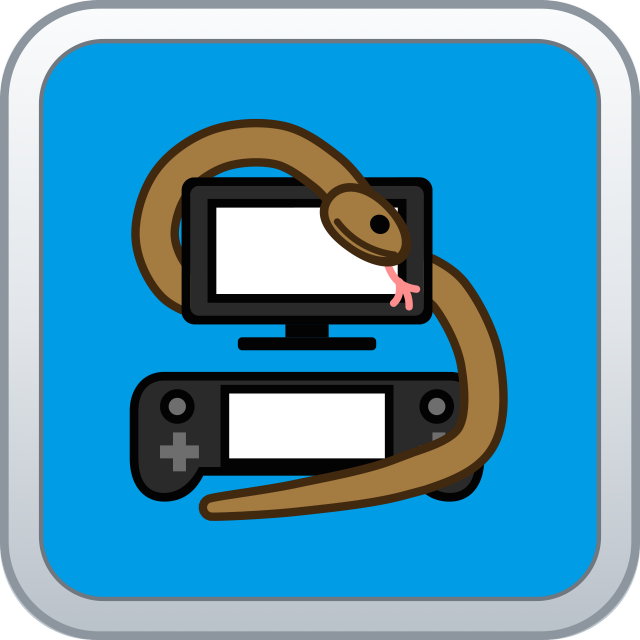
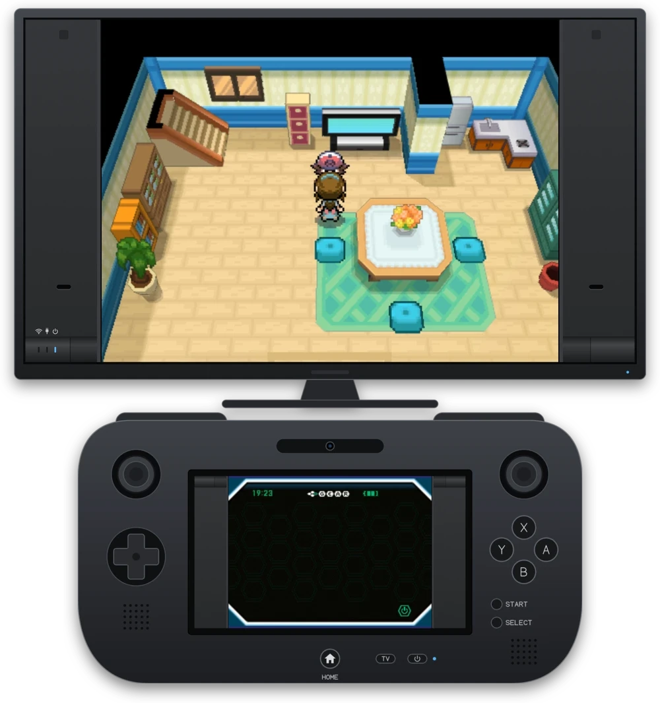

# NooDS U
A DS and GBA emulator for the Wii U.

### Overview
NooDS U is a Wii U-only fork of [NooDS](https://github.com/Hydr8gon/NooDS) by Hydr8gon, focused on running well on real
hardware.

Pokémon Black went from about 20 fps to 60 fps on a real Wii U, three times as fast. Most games should see a large jump
too, though few have been tested so far.

It's licensed under the GPL version 3, like NooDS.

What's new compared to NooDS

#### Speed
- JIT for both the ARM9 and ARM7, generating native PowerPC code
- GPU 3D renderer that draws with the Wii U's GPU instead of the CPU
- The emulator gets its own CPU core, with each 2D engine and 3D geometry on separate threads
- Fast CPU Timing and Fast 2D Threads options, which trade a little accuracy for speed
- Sync to Display, which runs one emulated frame per display refresh for smoother motion
- Smoother audio while games load, with smaller output buffers
- Faster memory access, 2D drawing, display capture, audio mixing, geometry processing and VRAM switching
- Screen upscaling and ghosting done on the GPU

#### GPU 3D renderer features
- High-resolution 3D
- DS-style anti-aliasing, with an optional multisampling mode
- Edge marking, fog, shadows, toon and highlight shading, wireframe, alpha test and rear-plane bitmaps

#### ROM loading
- "Keep ROM in RAM" can load the whole ROM first, with progress and cancel, or stream it in the background
- Loading a whole ROM is over twice as fast (a 256 MB ROM went from 28 to 13 seconds)
- Restarting reuses the ROM already in memory, so there's no second load
- Reads from the SD card are cached for ROMs that aren't kept in RAM

#### Wii U support
- TV + GamePad screen arrangements, with the top screen on the TV and the bottom one on the GamePad
- The GamePad can be turned on and off during a game
- Pro Controller and Classic Controller support
- HOME menu support
- GamePad microphone input, with a Blow into Mic hotkey for games that check for blowing
- Right stick pointer for the touch screen, with a rebindable touch hotkey
- Game Language setting, which defaults to the Wii U's system language
- Nickname setting, which defaults to the Wii U user's Mii name and is typed with the system keyboard

#### Wi-Fi
- Online play through the Wii U's internet connection, with an emulated access point (Experimental, off by default)
- Nintendo WFC games connect to replacement services such as Wiimmfi, through an editable DNS Server setting

#### Interface
- Simpler settings menu, with the fast options on by default
- File browser: set a default folder (Y), and open a ROM's launch options (−) to run it with a chosen save type
- Pause menu rearranged, and Restart asks for confirmation
- Optional Screen Frame setting: the space around the screens looks like a DSi, in any of its eight colours, with
  working lights: wireless for Wi-Fi, and charge and power for the GamePad's battery
- Version shown in the menus, and an About screen
- A new icon

#### Fixes
- 3D alpha test and rear-plane bitmaps, which weren't emulated before, now work in the software renderer too
- Games no longer sometimes freeze after loading a state
- Fixed several rare freezes and GPU hangs, including a stall caused by Aroma's file redirection
- Bitmap mode homebrew no longer shows a single stretched pixel
- A stale object window on the first frame after the display turns back on

#### For developers
- Debug build variants for profiling, frame timing and diagnosing freezes (`build-wiiu-debug.sh`)
- Hang reports written to `hang.txt`
- Automatic GitHub releases from version tags

### Alpha software
NooDS U is alpha software, especially the JIT. Expect some games to hang, crash or misbehave.

If something hangs or isn't working, try changing settings before reporting it. Turning off JIT is the first thing to
try, followed by Fast CPU Timing, Sync to Display and the GPU 3D Renderer.

When reporting a bug, include the game's name and the ROM's hash (SHA-1 or MD5), plus which settings you tried.

### Usage
Put `noodsu.wuhb` in `sd:/wiiu/apps/` on your SD card. Settings, states and cheats are kept in `sd:/wiiu/apps/noodsu/`, and saves next to the ROM.

NooDS U should be able to run most things without any setup. DS BIOS and firmware files must be provided to boot the
system menu, and can be dumped from a DS with [DSBF Dumper](https://archive.org/details/dsbf-dumper). The firmware must
come from an original DS; DSi and 3DS dumps don't contain any boot code. A GBA BIOS file can be optionally provided, and
can be dumped from many systems with [this dumper](https://github.com/mgba-emu/bios-dump). File paths can be configured
in the `noodsu.ini` file. Save types are automatically detected, but this may not always be accurate. If you run something
and it has issues with saving, the save type can be changed in the pause menu.

### Building
Install [devkitPro](https://devkitpro.org/wiki/Getting_Started) and its `wiiu-dev` package. Run `make -j$(nproc)` in the
project root directory to start building. `./build-wiiu-debug.sh` builds variants for debugging and measuring.

### References
* [GBATEK](https://problemkaputt.de/gbatek.htm) - The main information source for all things DS and GBA
* [GBATEK Addendum](https://melonds.kuribo64.net/board/thread.php?id=13) - A thread that aims to fill the gaps in GBATEK
* [melonDS Blog](https://melonds.kuribo64.net) - Contains posts that detail various 3D quirks
* [DraStic BIOS](https://drive.google.com/file/d/1dl6xgOXc892r43RzkIJKI6nikYIipzoN/view) - Reference for the DS HLE BIOS
functions
* [Cult of GBA BIOS](https://github.com/Cult-of-GBA/BIOS) - Reference for the GBA HLE BIOS functions
